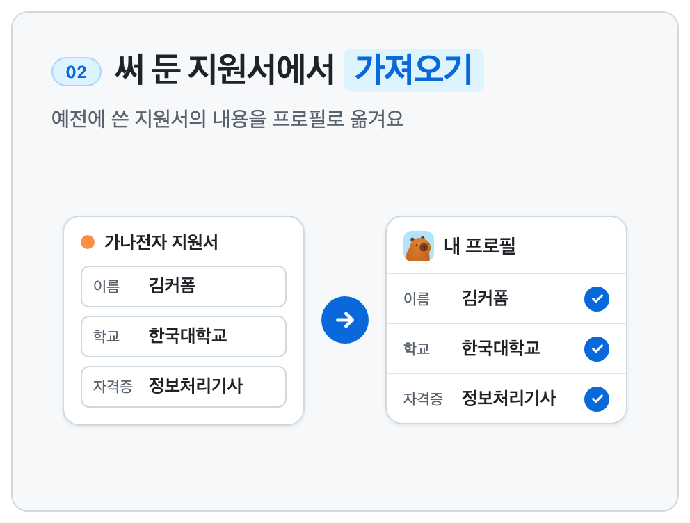
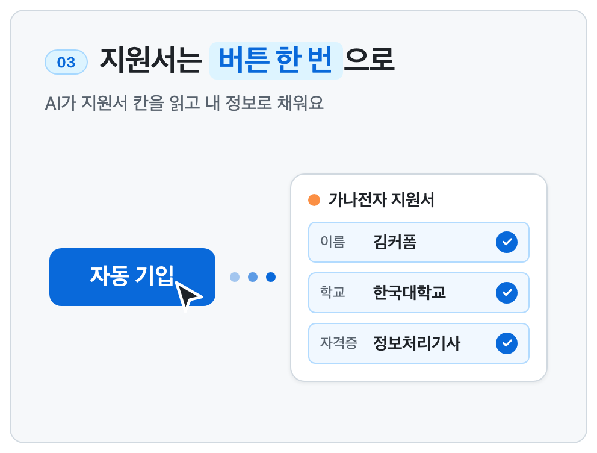
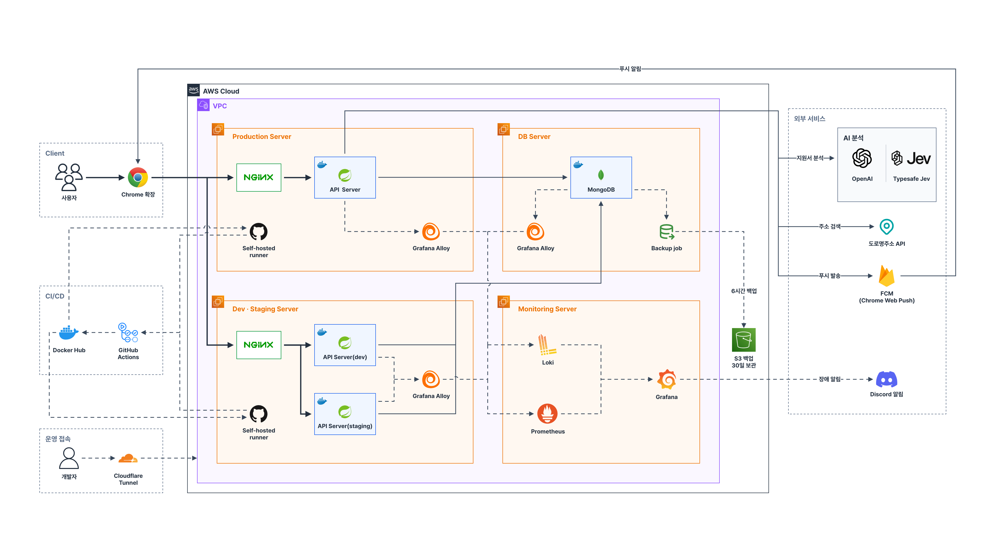

# 2026 Career Form

지원서 입력, 이제 한 번만. 
내 정보를 등록해 두면 채용 지원서를 자동으로 채워 주는 Chrome 확장 프로그램이에요.

## 주요 기능

<picture><source media="(prefers-color-scheme: dark)" srcset=".github/images/feature-1-profile-dark.png"></picture> <picture><source media="(prefers-color-scheme: dark)" srcset=".github/images/feature-2-import-dark.png"></picture>
<picture><source media="(prefers-color-scheme: dark)" srcset=".github/images/feature-3-autofill-dark.png"></picture> <picture><source media="(prefers-color-scheme: dark)" srcset=".github/images/feature-4-result-dark.png"></picture>
<picture><source media="(prefers-color-scheme: dark)" srcset=".github/images/feature-5-submit-dark.png"></picture> <picture><source media="(prefers-color-scheme: dark)" srcset=".github/images/feature-6-alert-dark.png"></picture>

## 기술 스택

| 영역 | 기술 |
| :---: | :--- |
| **Extension** |       |
| **Backend** |     |
| **AI** | ![Jev](https://img.shields.io/badge/Jev-30363D?style=flat&logo=data%3Aimage%2Fpng%3Bbase64%2CiVBORw0KGgoAAAANSUhEUgAAABwAAAAcCAYAAAByDd%2BUAAAAAXNSR0IArs4c6QAAAIplWElmTU0AKgAAAAgABQEaAAUAAAABAAAASgEbAAUAAAABAAAAUgEoAAMAAAABAAIAAAExAAIAAAAGAAAAWodpAAQAAAABAAAAYAAAAAAAAABIAAAAAQAAAEgAAAABRmlnbWEAAAOgAQADAAAAAQABAACgAgAEAAAAAQAAABygAwAEAAAAAQAAABwAAAAAJ2zPfQAAAAlwSFlzAAALEwAACxMBAJqcGAAAAVlpVFh0WE1MOmNvbS5hZG9iZS54bXAAAAAAADx4OnhtcG1ldGEgeG1sbnM6eD0iYWRvYmU6bnM6bWV0YS8iIHg6eG1wdGs9IlhNUCBDb3JlIDYuMC4wIj4KICAgPHJkZjpSREYgeG1sbnM6cmRmPSJodHRwOi8vd3d3LnczLm9yZy8xOTk5LzAyLzIyLXJkZi1zeW50YXgtbnMjIj4KICAgICAgPHJkZjpEZXNjcmlwdGlvbiByZGY6YWJvdXQ9IiIKICAgICAgICAgICAgeG1sbnM6eG1wPSJodHRwOi8vbnMuYWRvYmUuY29tL3hhcC8xLjAvIj4KICAgICAgICAgPHhtcDpDcmVhdG9yVG9vbD5GaWdtYTwveG1wOkNyZWF0b3JUb29sPgogICAgICA8L3JkZjpEZXNjcmlwdGlvbj4KICAgPC9yZGY6UkRGPgo8L3g6eG1wbWV0YT4KBP9cyAAABjJJREFUSA29Vn1MlVUY%2F53zvnC5gCJ%2Bi6j5sUzBj1AsXc2aX6WhoWJrmgzNQqf9UYka6oykzNS1tYYsP6abm4mmkyyH1qy1XFFoIGql8o2oGaLCvRfej57nXO%2FlcgXn%2FKPn3Xnve99z3t%2FvPN9H4CHl2pyTgwzLHiEhRkHY6bYNSSNHE9pZ6Fpx77yJZQ8DJR60qDYpP1wPdaZYNlJtIDFE6JFSCHisZvWZQ4bCIlbDNu4AotAW9l672ZUXk5%2FU1BFuh4TVs0%2FMCBHaRhqjLdhosVoUOAMJulhsulh4EyEyBKQ9WmzzrAUjs8%2Bhqd%2BoyaDbfYQHUg5ozxhdsjSprZaQspmIAiWUgO8aXgUi9XC0N2%2FBskzL3PSTfmv9vLx5ZuD3bQhtIqs1onLCdecSl%2BHxa8AfSCHhECH4taEUm8r2KIzVA1ORGBWHZpu1t%2Fy4rGmY7kCT4foiRm9YKgJIdf8qeqghzSL0MCJz3zOWd5Z91WDcxbaqfdhb02qp1JL3kdp3Bt6ITUaEFgY2PQv%2FMgZvvMYQN%2BhVppqgm1%2FDquTjLxDw14Zlaj7faKQVBQp%2BrD%2BLDy7vxI3meqwdvAjf3SxU30%2FqloisSzswvssIfDZ8JWzS0kvphWdf61JaHtN4qd%2BRad%2FyW8m32qTfwjXIzbTAT8YmrG%2B5g3WXcrGoJAuDnDHIT9iGBTEvwmV61FgcOxMLY2ag0n2tjUkZk4U3LigOKKY2c8TzO2VSodfPdWiOEQzEImgFP6eXbkIVgW0eugKv9J6CcvdVpBF5YcN5te71c9mgjYIDyRu5gfqpJSqowrWweA%2FkXHqzV9IuBI20QGPwx5xrle46vDtwvtLqy7qTmH1mFSpcdciNW6PGX40VOHTte1LFJr9ZyvxemrZ3xjZhL9qwYYOUdS%2BfGmALJHKeBQqT%2BnzYZLqxp%2BYYqogsMWoYjeFqPNn5CWW2i0S8rHQzLrmq4ZSOQBj1zNgULInppeMH6JZsGekQoRG%2B6hG8ujWABJ7qEo8T%2F%2FyCotsXiQi42dyABCK9TsF0s6UBKWfW4B2yCJvf9x3jcTWigAz3WJ54Sf8S2KsPEvYRVRBM7jYO%2BWO2kblblG8OJ3yCZ6NHIzqkE%2FaP2ojpPSbg0%2FL9uG00qrwNxFQcpkygHBVLO9KOP%2BBoPX7jNK401aCAtHOTb4dHDsLjEf0xJDyWiA2YlA6RulOlR4jUAnn8z8xBeqXr5KvWEuGf9j6wZrmVh1HtuY5p3Z9W4Z9clEF1U8OYzsOoaLdWLTZbi20EIbT9S2aW3GK2cyUJFg4aBrzYWI7MQWnIiVulzDYheiT%2BbKxUBZvXeK%2FWgh6M4%2FuvOGw7R4dmFfHuAoXrYmcqzGuoVm4p34ed1UeVn9isp%2F79XWnL5Yw9zyZms7Loon1z8pzikKJI1yTOeYzmJnJqeCAx587MnhMxllJga9k%2BrLiwBZGaE8v7p4ArDJNkX96NA3UnVBC9dWGr8imnUrBwwHjs5kZphRTL7XGnK0i%2FQu5nweK2POgZGo1NQ5djMAXIq32mUSFYQB3jPBWBDOyqOYq3H5uPHfGZqgp9XplHWss2KcGYjE3VpbD3kecqJGW%2FpUHs4pbSnpjkRx6h1Jq4AKz%2FOxcLitejB23k0OiPsaTfLDzfdSzm9HoeLtpgH0c3zrk2pIxN124atqqltuE%2B2ARrJS2MD26ovk2wf%2FZfLUD30C7IGvImUnpPAtVICqAKfHRlj%2FJtWt8kLOs%2FF07N4S%2FmHOlu01MCo%2BtBxlIG5zMIxU0GVUSL9xIsnIu9HF2pJzZiFvn1NeoYLBxMyWTaMlctmXUtNgxZooLL14wZi1LBNGFlxOSPVceENujVyQXZ1IDfC27AbJK7pksR7K7Jxzjq8iw%2F3yrGotgkpPebgyg90n%2B44jkGduphaDTcH8Yennp%2FA%2BZFgUcMNx0xAjsIa%2Bk9YpynZryDl2Pd4MWK3BN0xGDNnB0cMdpoyCD%2F6yGKCX1ydU7BdAk9%2B1GOiVTo18Z%2BNeWYDyvw9z4NAyf5WCDoICxssZAMnqgLvZNKYqouLBz%2B92roXQIqlAJ7jEc9CAcS83Ndyg8DYZgjKSdHU%2BFYSoNcLLbT7Q9dipJehyZfCf6mvf%2F%2FARlk60sAvdXqAAAAAElFTkSuQmCC) ![OpenAI](https://img.shields.io/badge/OpenAI-30363D?style=flat&logo=data%3Aimage%2Fsvg%2Bxml%3Bbase64%2CPHN2ZyByb2xlPSJpbWciIHZpZXdCb3g9IjAgMCAyNCAyNCIgeG1sbnM9Imh0dHA6Ly93d3cudzMub3JnLzIwMDAvc3ZnIj48cGF0aCBmaWxsPSIjRkZGRkZGIiBkPSJNMjIuMjgxOSA5LjgyMTFhNS45ODQ3IDUuOTg0NyAwIDAgMC0uNTE1Ny00LjkxMDggNi4wNDYyIDYuMDQ2MiAwIDAgMC02LjUwOTgtMi45QTYuMDY1MSA2LjA2NTEgMCAwIDAgNC45ODA3IDQuMTgxOGE1Ljk4NDcgNS45ODQ3IDAgMCAwLTMuOTk3NyAyLjkgNi4wNDYyIDYuMDQ2MiAwIDAgMCAuNzQyNyA3LjA5NjYgNS45OCA1Ljk4IDAgMCAwIC41MTEgNC45MTA3IDYuMDUxIDYuMDUxIDAgMCAwIDYuNTE0NiAyLjkwMDFBNS45ODQ3IDUuOTg0NyAwIDAgMCAxMy4yNTk5IDI0YTYuMDU1NyA2LjA1NTcgMCAwIDAgNS43NzE4LTQuMjA1OCA1Ljk4OTQgNS45ODk0IDAgMCAwIDMuOTk3Ny0yLjkwMDEgNi4wNTU3IDYuMDU1NyAwIDAgMC0uNzQ3NS03LjA3Mjl6bS05LjAyMiAxMi42MDgxYTQuNDc1NSA0LjQ3NTUgMCAwIDEtMi44NzY0LTEuMDQwOGwuMTQxOS0uMDgwNCA0Ljc3ODMtMi43NTgyYS43OTQ4Ljc5NDggMCAwIDAgLjM5MjctLjY4MTN2LTYuNzM2OWwyLjAyIDEuMTY4NmEuMDcxLjA3MSAwIDAgMSAuMDM4LjA1MnY1LjU4MjZhNC41MDQgNC41MDQgMCAwIDEtNC40OTQ1IDQuNDk0NHptLTkuNjYwNy00LjEyNTRhNC40NzA4IDQuNDcwOCAwIDAgMS0uNTM0Ni0zLjAxMzdsLjE0Mi4wODUyIDQuNzgzIDIuNzU4MmEuNzcxMi43NzEyIDAgMCAwIC43ODA2IDBsNS44NDI4LTMuMzY4NXYyLjMzMjRhLjA4MDQuMDgwNCAwIDAgMS0uMDMzMi4wNjE1TDkuNzQgMTkuOTUwMmE0LjQ5OTIgNC40OTkyIDAgMCAxLTYuMTQwOC0xLjY0NjR6TTIuMzQwOCA3Ljg5NTZhNC40ODUgNC40ODUgMCAwIDEgMi4zNjU1LTEuOTcyOFYxMS42YS43NjY0Ljc2NjQgMCAwIDAgLjM4NzkuNjc2NWw1LjgxNDQgMy4zNTQzLTIuMDIwMSAxLjE2ODVhLjA3NTcuMDc1NyAwIDAgMS0uMDcxIDBsLTQuODMwMy0yLjc4NjVBNC41MDQgNC41MDQgMCAwIDEgMi4zNDA4IDcuODcyem0xNi41OTYzIDMuODU1OEwxMy4xMDM4IDguMzY0IDE1LjExOTIgNy4yYS4wNzU3LjA3NTcgMCAwIDEgLjA3MSAwbDQuODMwMyAyLjc5MTNhNC40OTQ0IDQuNDk0NCAwIDAgMS0uNjc2NSA4LjEwNDJ2LTUuNjc3MmEuNzkuNzkgMCAwIDAtLjQwNy0uNjY3em0yLjAxMDctMy4wMjMxbC0uMTQyLS4wODUyLTQuNzczNS0yLjc4MThhLjc3NTkuNzc1OSAwIDAgMC0uNzg1NCAwTDkuNDA5IDkuMjI5N1Y2Ljg5NzRhLjA2NjIuMDY2MiAwIDAgMSAuMDI4NC0uMDYxNWw0LjgzMDMtMi43ODY2YTQuNDk5MiA0LjQ5OTIgMCAwIDEgNi42ODAyIDQuNjZ6TTguMzA2NSAxMi44NjNsLTIuMDItMS4xNjM4YS4wODA0LjA4MDQgMCAwIDEtLjAzOC0uMDU2N1Y2LjA3NDJhNC40OTkyIDQuNDk5MiAwIDAgMSA3LjM3NTctMy40NTM3bC0uMTQyLjA4MDVMOC43MDQgNS40NTlhLjc5NDguNzk0OCAwIDAgMC0uMzkyNy42ODEzem0xLjA5NzYtMi4zNjU0bDIuNjAyLTEuNDk5OCAyLjYwNjkgMS40OTk4djIuOTk5NGwtMi41OTc0IDEuNDk5Ny0yLjYwNjctMS40OTk3WiIvPjwvc3ZnPg%3D%3D)   |
| **Infra** | ![AWS EC2](https://img.shields.io/badge/AWS_EC2-30363D?style=flat&logo=data%3Aimage%2Fsvg%2Bxml%3Bbase64%2CPHN2ZyByb2xlPSJpbWciIHZpZXdCb3g9IjAgMCAyNCAyNCIgeG1sbnM9Imh0dHA6Ly93d3cudzMub3JnLzIwMDAvc3ZnIj48cGF0aCBmaWxsPSIjRkY5OTAwIiBkPSJNNi40MjkgMTcuNTcxaDEwLjcxNFY2Ljg1N0g2LjQyOXYxMC43MTRaTTE4IDYuODU3aDEuNzE0di44NTdIMThWOS40M2gxLjcxNHYuODU3SDE4djEuMjg1aDEuNzE0di44NThIMTh2MS43MTRoMS43MTRWMTVIMTh2MS43MTRoMS43MTR2Ljg1N0gxOHYuMDU5YS44LjggMCAwIDEtLjc5OS43OTloLS4wNTh2MS43MTRoLS44NTd2LTEuNzE0SDE0LjU3djEuNzE0aC0uODU3di0xLjcxNEgxMi40M3YxLjcxNGgtLjg1OHYtMS43MTRIOS44NTd2MS43MTRIOXYtMS43MTRINy4yODZ2MS43MTRoLS44NTd2LTEuNzE0SDYuMzdhLjguOCAwIDAgMS0uNzk5LS44di0uMDU4SDQuMjg2di0uODU3SDUuNTdWMTVINC4yODZ2LS44NTdINS41N3YtMS43MTRINC4yODZ2LS44NThINS41N3YtMS4yODVINC4yODZ2LS44NTdINS41N1Y3LjcxNEg0LjI4NnYtLjg1N0g1LjU3VjYuOGEuOC44IDAgMCAxIC44LS43OTloLjA1OFY0LjI4NmguODU3VjZIOVY0LjI4NmguODU3VjZoMS43MTRWNC4yODZoLjg1OFY2aDEuMjg1VjQuMjg2aC44NTdWNmgxLjcxNVY0LjI4NmguODU3VjZoLjA1OGEuOC44IDAgMCAxIC43OTkuNzk5di4wNThaTTEyLjQyOSAyMy4wOWEuMDU0LjA1NCAwIDAgMS0uMDU0LjA1M0guOTFhLjA1My4wNTMgMCAwIDEtLjA1My0uMDUzVjExLjYyNWMwLS4wMy4wMjQtLjA1NC4wNTMtLjA1NGgyLjUydi0uODU3SC45MWEuOTExLjkxMSAwIDAgMC0uOTEuOTFWMjMuMDljMCAuNTAyLjQwOC45MS45MS45MWgxMS40NjVhLjkxLjkxIDAgMCAwIC45MS0uOTFWMjFoLS44NTZaTTI0IC45MXYxMS40NjVhLjkxLjkxIDAgMCAxLS45MS45MWgtMi41MnYtLjg1NmgyLjUxOWEuMDU0LjA1NCAwIDAgMCAuMDUzLS4wNTRWLjkxYS4wNTMuMDUzIDAgMCAwLS4wNTMtLjA1M0gxMS42MjVhLjA1My4wNTMgMCAwIDAtLjA1NC4wNTN2Mi41MmgtLjg1N1YuOTFjMC0uNTAyLjQwOS0uOTEuOTEtLjkxSDIzLjA5YS45MS45MSAwIDAgMSAuOTEuOTFaIi8%2BPC9zdmc%2B) ![AWS S3](https://img.shields.io/badge/AWS_S3-30363D?style=flat&logo=data%3Aimage%2Fsvg%2Bxml%3Bbase64%2CPHN2ZyByb2xlPSJpbWciIHZpZXdCb3g9IjAgMCAyNCAyNCIgeG1sbnM9Imh0dHA6Ly93d3cudzMub3JnLzIwMDAvc3ZnIj48cGF0aCBmaWxsPSIjNTY5QTMxIiBkPSJNMjAuOTEzIDEzLjE0N2wuMTItLjg5NWMuOTQ3LjU3NiAxLjI1OC45MjIgMS4zNTQgMS4wNzEtLjE2LjAzMS0uNTYyLjA0Ni0xLjQ3NC0uMTc2em0tMi4xNzQgNy45ODhhLjU0Ny41NDcgMCAwIDAtLjAwNS4wNzNjMCAuMDg0LS4yMDcuNDA1LTEuMTI0Ljc2OGExMC4yOCAxMC4yOCAwIDAgMS0xLjQzOC40MzJjLTEuNDA1LjMyNS0zLjEyOC41MDQtNC44NTMuNTA0LTQuNjEyIDAtNy40MTItMS4xODQtNy40MTItMS43MDRhLjU0Ny41NDcgMCAwIDAtLjAwNS0uMDczTDEuODEgNS42MDJjLjEzNS4wNzguMjguMTU0LjQzMi4yMjcuMDQyLjAyLjA4Ni4wMzguMTI4LjA1Ny4xMzQuMDYyLjI3Mi4xMjIuNDE3LjE4bC4xNzkuMDY5Yy4xNTQuMDU4LjMxNC4xMTQuNDc4LjE2OC4wNDMuMDEzLjA4NC4wMjkuMTMuMDQzLjIwNy4wNjUuNDIzLjEyNy42NDYuMTg3bC4xNzYuMDQ0Yy4xNzUuMDQ0LjM1My4wODcuNTM0LjEyN2EyMy40MTQgMjMuNDE0IDAgMCAwIC44NDMuMTdsLjEyMS4wMjNjLjI1Mi4wNDUuNTA4LjA4NS43NjguMTIyLjA3MS4wMTEuMTQ0LjAyLjIxNi4wMy4yLjAyNy40LjA1My42MDQuMDc3bC4yNC4wMjdjLjI0NS4wMjYuNDkuMDUuNzQuMDdsLjA4MS4wMDljLjI3NS4wMjIuNTUyLjA0LjgzLjA1NmwuMjMzLjAxMmMuMjEuMDEuNDIyLjAxOC42MzMuMDI1YTMzLjA4OCAzMy4wODggMCAwIDAgMi43OTUtLjAyNmwuMjMyLS4wMTFjLjI3OC0uMDE2LjU1NS0uMDM0LjgzLS4wNTZsLjA4LS4wMDhjLjI1LS4wMi40OTctLjA0NS43NDItLjA3MmwuMjM4LS4wMjZjLjIwNS0uMDI0LjQwOC0uMDUuNjA5LS4wNzcuMDctLjAxLjE0MS0uMDE5LjIxMS0uMDMuMjYxLS4wMzcuNTE5LS4wNzguNzcyLS4xMjJsLjExMS0uMDJjLjIxNS0uMDQuNDI3LS4wODIuNjM0LS4xMjVsLjIxMi0uMDQ3Yy4xODYtLjA0MS4zNjgtLjA4NS41NDYtLjEzbC4xNjYtLjA0MmMuMjI1LS4wNi40NDQtLjEyMi42NTQtLjE4OS4wNC0uMDEyLjA3Ny0uMDI2LjExNS0uMDM4YTEwLjYgMTAuNiAwIDAgMCAuNDkzLS4xNzNjLjA1OC0uMDIxLjExNC0uMDQ0LjE3LS4wNjYuMTUtLjA2LjI5My0uMTIuNDMtLjE4NS4wMzgtLjAxNy4wNzktLjAzNC4xMTYtLjA1Mi4xNTMtLjA3My4zLS4xNS40MzYtLjIyOGwtLjk3NiA3LjI0NWMtMi40ODgtLjc4LTUuODA1LTIuMjkyLTcuMzExLTNhMS4wOSAxLjA5IDAgMCAwLTEuMDg4LTEuMDg1Yy0uNiAwLTEuMDg4LjQ4OS0xLjA4OCAxLjA4OCAwIC42LjQ4OCAxLjA4OSAxLjA4OCAxLjA4OS4xOTYgMCAuMzc4LS4wNTYuNTM3LS4xNDggMS43Mi44MTIgNS4xNDQgMi4zNjcgNy43MTUgMy4xNXptLTcuNDItMjAuMDQ3YzUuNjc3IDAgOS42NzYgMS43NTkgOS43NSAyLjczNmwtLjAxNC4xMTNjLS4wMS4wMzMtLjAzMS4wNjctLjA0OC4xMDEtLjAxNS4wMjgtLjAyNi4wNTctLjA0Ny4wODctLjAyNC4wMzMtLjA1OC4wNjgtLjA5LjEwMi0uMDI4LjAzLS4wNTEuMDYtLjA4NC4wOS0uMDM4LjAzNS0uMDg3LjA3LS4xMzMuMTA1LS4wNC4wMy0uMDc0LjA2LS4xMTkuMDkxLS4wNTMuMDM2LS4xMTYuMDcxLS4xNzcuMTA3LS4wNS4wMy0uMDk1LjA2LS4xNS4wOS0uMDY4LjAzNi0uMTQ3LjA3My0uMjIyLjExLS4wNTkuMDI4LS4xMTQuMDU3LS4xNzcuMDg1LS4wODQuMDM4LS4xNzcuMDc0LS4yNjguMTExLS4wNjguMDI3LS4xMy4wNTQtLjIwMy4wODItLjA5Ny4wMzYtLjIwNS4wNzItLjMxLjEwNy0uMDc1LjAyNi0uMTQ4LjA1My0uMjI4LjA3OS0uMTExLjAzNS0uMjMzLjA2OS0uMzUuMTAzLS4wODUuMDI0LS4xNjUuMDUtLjI1My4wNzMtLjEyNC4wMzQtLjI1OC4wNjUtLjM4OS4wOTgtLjA5My4wMjItLjE4MS4wNDYtLjI3OC4wNjgtLjEzOS4wMzItLjI4Ny4wNjEtLjQzMy4wOTEtLjA5OC4wMi0uMTkxLjA0MS0uMjkzLjA2LS4xNTUuMDMtLjMyLjA1Ny0uNDgyLjA4NC0uMS4wMTgtLjE5OC4wMzYtLjMwMi4wNTItLjE2Ni4wMjYtLjM0Mi4wNDgtLjUxNS4wNzItLjExLjAxNC0uMjEzLjAzLS4zMjUuMDQ0LS4xODEuMDIzLS4zNzIuMDQxLS41Ni4wNi0uMTEuMDEyLS4yMTguMDI1LS4zMzIuMDM2LS4xODguMDE2LS4zODYuMDI5LS41OC4wNDMtLjEyMi4wMDktLjI0LjAyLS4zNjQuMDI4LS4yMDcuMDEyLS40MjIuMDItLjYzNS4wMjgtLjEyLjAwNS0uMjM0LjAxMi0uMzU0LjAxNmEzNS42MDUgMzUuNjA1IDAgMCAxLTIuMDY5IDBjLS4xMi0uMDA0LS4yMzQtLjAxMS0uMzUyLS4wMTYtLjIxNC0uMDA4LS40My0uMDE2LS42MzctLjAyOC0uMTIyLS4wMDgtLjIzOC0uMDItLjM2LS4wMjctLjE5NS0uMDE1LS4zOTQtLjAyOC0uNTg0LS4wNDQtLjExLS4wMS0uMjE1LS4wMjQtLjMyNC0uMDM1LS4xOS0uMDItLjM4NC0uMDM4LS41NjgtLjA2bC0uMzE1LS4wNDRjLS4xNzYtLjAyNC0uMzU1LS4wNDYtLjUyNS0uMDczLS4xLS4wMTUtLjE5Mi0uMDMzLS4yOS0uMDUtLjE2Ny0uMDI4LS4zMzUtLjA1NS0uNDk0LS4wODYtLjA5Ni0uMDE4LS4xODMtLjAzOC0uMjc2LS4wNTYtLjE1MS0uMDMyLS4zMDUtLjA2Mi0uNDUtLjA5NS0uMDktLjAyLS4xNzMtLjA0My0uMjYtLjA2NC0uMTM4LS4wMzQtLjI3Ny0uMDY3LS40MDctLjEwMi0uMDgyLS4wMjItLjE1Ny0uMDQ2LS4yMzUtLjA2OWExMS43NSAxMS43NSAwIDAgMS0uMzY4LS4xMDhjLS4wNzUtLjAyNC0uMTQxLS4wNDktLjIxMy0uMDczLS4xMS0uMDM3LS4yMjMtLjA3NS0uMzI1LS4xMTMtLjA2Ny0uMDI1LS4xMjUtLjA1MS0uMTg4LS4wNzctLjA5Ni0uMDM4LS4xOTUtLjA3Ni0uMjgyLS4xMTUtLjA2LS4wMjctLjExLS4wNTQtLjE2Ni0uMDgtLjA4LS4wMzktLjE2Mi0uMDc3LS4yMzMtLjExNi0uMDUyLS4wMjgtLjA5NC0uMDU1LS4xNDItLjA4NC0uMDYzLS4wMzgtLjEzLS4wNzUtLjE4NS0uMTEzLS4wNDMtLjAyOS0uMDc1LS4wNTgtLjExMy0uMDg2LS4wNDgtLjAzNy0uMDk4LS4wNzMtLjEzOS0uMTEtLjAzMi0uMDI5LS4wNTQtLjA1Ny0uMDgtLjA4Ny0uMDMzLS4wMzUtLjA2OS0uMDctLjA5My0uMTA0LS4wMi0uMDMtLjAzMS0uMDU4LS4wNDYtLjA4Ni0uMDE4LS4wMzUtLjAzOS0uMDY4LS4wNDktLjEwMmwtLjAxNS0uMTEzYy4wNzYtLjk3NyA0LjA3NC0yLjczNiA5Ljc0OC0yLjczNnptMTIuMTgyIDEyLjEyNGMtLjExOC0uNjI4LS44NC0xLjI5MS0yLjMxLTIuMTI4bC45NjMtNy4xNmEuNTMxLjUzMSAwIDAgMCAuMDA1LS4wNzNDMjIuMTYgMS41ODEgMTYuNDQ3IDAgMTEuMzIgMCA2LjE5NCAwIC40ODIgMS41ODEuNDgyIDMuODUxYS41OC41OCAwIDAgMCAuMDA1LjA3MkwyLjgxOSAyMS4yNWMuMDcxIDIuMDAyIDUuMjM2IDIuNzUgOC41IDIuNzUgMS44MDUgMCAzLjYxNS0uMTg4IDUuMDk4LS41MzEuNTk4LS4xMzggMS4xMzMtLjMgMS41OTItLjQ4IDEuMTgtLjQ2NyAxLjc4OS0xLjA1MyAxLjgxMy0xLjczOWwuOTQ1LTcuMDE4Yy41NTcuMTMxIDEuMDE2LjE5NyAxLjM4OS4xOTcuNTQgMCAuOTAyLS4xMzcgMS4xMzQtLjQxM2EuOTU2Ljk1NiAwIDAgMCAuMjEtLjgwNFoiLz48L3N2Zz4%3D)     |
| **Monitoring** |     |
| **Test** |    |
| **External** |   |

## 인프라 구성도

## 팀원

|  |  |  |  |
| :---: | :---: | :---: | :---: |
| [티모(윤호준)](https://github.com/Yoonhojoon) | [영기(김기영)](https://github.com/Giyoul) | [모아(정회창)](https://github.com/picetea44) | [레서(한승규)](https://github.com/win9-tech) |

